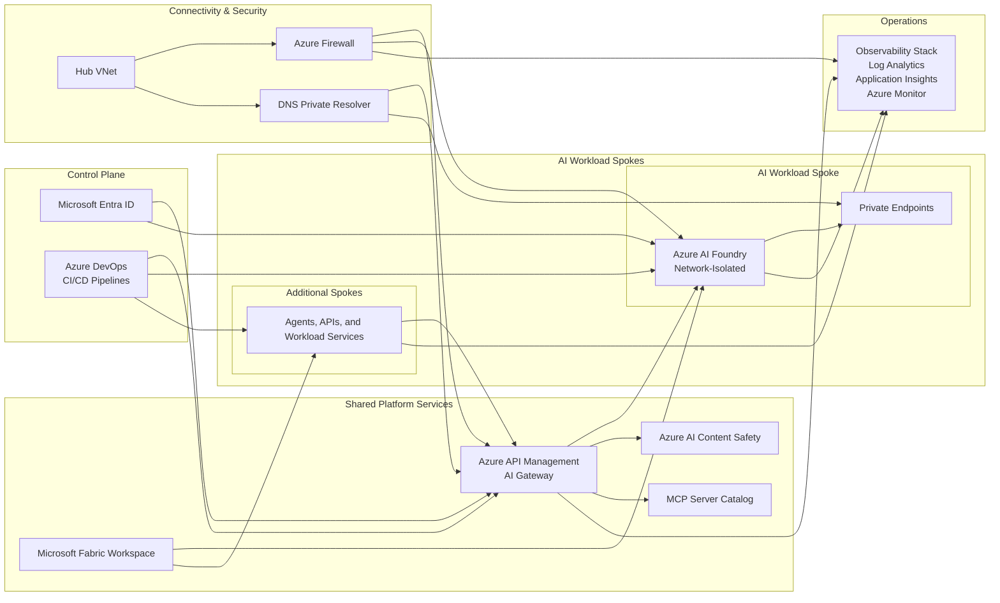

# Azure AI Platform — Reference Architecture

[](#)
[](#)
[](#license)

## Overview

This repository provides a production-ready reference architecture for standing up an enterprise Azure AI Platform on Azure using **Azure AI Foundry**, **Microsoft Fabric**, **Azure API Management**, and **Azure DevOps**.

The goal is to give platform teams a repeatable foundation for secure, governed, and scalable AI adoption. Instead of building every new workload from scratch, teams can use this repository to provision the core platform and then onboard new AI workloads—such as **Azure AI Foundry projects**, **APIM products**, and **Copilot Studio agents**—in **hours, not weeks**.

This reference architecture is designed for enterprises that need:

- Centralized platform standards with reusable infrastructure patterns
- Network isolation and private connectivity for AI services
- Standardized CI/CD and environment promotion through Azure DevOps
- Governed API exposure through APIM and AI Gateway policies
- Observability, policy enforcement, and operational guardrails by default
- A consistent path for onboarding future AI workloads across environments

## Architecture Diagram



## Repository Structure

```text
├── terraform/
│   ├── modules/          # Shared reusable modules
│   ├── compositions/     # Root modules composing shared modules
│   └── environments/     # Per-environment variable files
├── pipelines/
│   ├── templates/        # Reusable pipeline templates
│   ├── infra/            # Infrastructure deployment pipelines
│   └── deploy/           # Application/agent deployment pipelines
├── policies/
│   ├── azure-policy/     # Azure Policy definitions
│   └── apim-policy/      # APIM policy XML templates
├── docs/
│   ├── adr/              # Architecture Decision Records
│   ├── architecture/     # Architecture guides and diagrams
│   └── guides/           # Getting started and how-to guides
├── scripts/              # Operational scripts
└── .azuredevops/         # Azure DevOps PR templates
```

### What lives where

- **terraform/** contains the reusable platform building blocks and environment-specific compositions used to deploy the landing zone and AI platform services.
- **pipelines/** defines Azure DevOps pipelines for validating, planning, deploying, and promoting infrastructure and downstream workloads.
- **policies/** stores governance controls for Azure Policy and Azure API Management policy templates.
- **docs/** contains architecture guidance, operational runbooks, and decision records.
- **scripts/** holds supporting automation for operators and pipeline execution.
- **.azuredevops/** contains templates and standards for pull requests and delivery workflows.

## Key Design Decisions

The platform is guided by a set of architecture decisions captured as ADRs in `docs/adr/`.

- **Terraform state management** — remote backend per environment to isolate state, enable RBAC, and support safe parallel delivery. See `docs/adr/ADR-terraform-state-management.md`.
- **Module composition pattern** — shared modules are assembled through composition/root modules rather than copied per workload. See `docs/adr/ADR-module-composition-pattern.md`.
- **Environment promotion** — workloads progress through `sandbox → poc → prod` using repeatable validation and approval gates. See `docs/adr/ADR-environment-promotion.md`.
- **Naming conventions** — consistent naming supports discoverability, automation, and policy enforcement. See `docs/adr/ADR-naming-conventions.md`.
- **Tagging strategy** — mandatory tags enable cost allocation, ownership, lifecycle tracking, and operations. See `docs/adr/ADR-tagging-strategy.md`.
- **Network topology** — hub-spoke networking with private endpoints protects data paths and centralizes shared controls. See `docs/adr/ADR-network-topology.md`.

## Getting Started

### Prerequisites

Before you begin, ensure you have access to:

- An Azure subscription or management group scope appropriate for the target environment
- **Azure CLI** authenticated to the correct tenant and subscription
- **Terraform** version approved by the platform team
- **Azure DevOps** project access, including pipeline execution permissions
- Appropriate permissions for resource provisioning, policy assignment, and service connections

Recommended supporting tools:

- Git
- PowerShell or Bash shell
- Mermaid-compatible Markdown viewer for architecture diagrams

### Quick Start

1. **Clone the repository**
   ```bash
   git clone <repo-url>
   cd msf-iac-ado
   ```
2. **Authenticate and select your Azure context**
   ```bash
   az login
   az account set --subscription <subscription-id>
   ```
3. **Review environment configuration**
   - Select the target variable set under `terraform/environments/`
   - Confirm naming, tags, network ranges, and workload inputs
4. **Initialize Terraform for the selected composition**
   ```bash
   cd terraform/compositions/<composition-name>
   terraform init
   terraform plan -var-file=..\..\environments\<environment>.tfvars
   ```
5. **Deploy through Azure DevOps**
   - Use the pipelines under `pipelines/infra/` for platform deployment
   - Use the pipelines under `pipelines/deploy/` for workload, agent, or application rollout
6. **Validate platform readiness**
   - Confirm private connectivity, DNS resolution, policy compliance, and monitoring signals
   - Verify APIM products, Foundry connectivity, and workload onboarding paths

## Environment Promotion Model

This repository assumes a staged promotion path:

```text
sandbox → poc → prod
```

### sandbox

Used for rapid experimentation, module development, and validating new workload patterns with reduced risk.

### poc

Used for controlled proof-of-concept deployments with tighter governance, integration validation, and stakeholder review.

### prod

Used for business-critical workloads with full operational controls, change management, observability, and support expectations.

### Promotion principles

- Promote the **same reusable modules and compositions**, not one-off environment forks
- Validate with plans, policy checks, and approvals before progressing
- Keep environment-specific values in controlled variable files and pipeline parameters
- Treat production promotion as a governed release event with auditable pipeline history

## Contributing

Contributions should follow the repository standards for infrastructure, documentation, and delivery automation.

- Create focused changes with clear intent
- Update documentation and ADRs when architectural behavior changes
- Validate Terraform plans and relevant Azure DevOps pipelines before merging
- Follow naming, tagging, and environment promotion standards defined by the platform
- Use pull requests for review and traceability

If you are adding new modules, policies, or deployment paths, prefer reusable patterns over environment-specific duplication.

## License

This project is licensed under the **MIT License**. See `LICENSE` for the full text.
