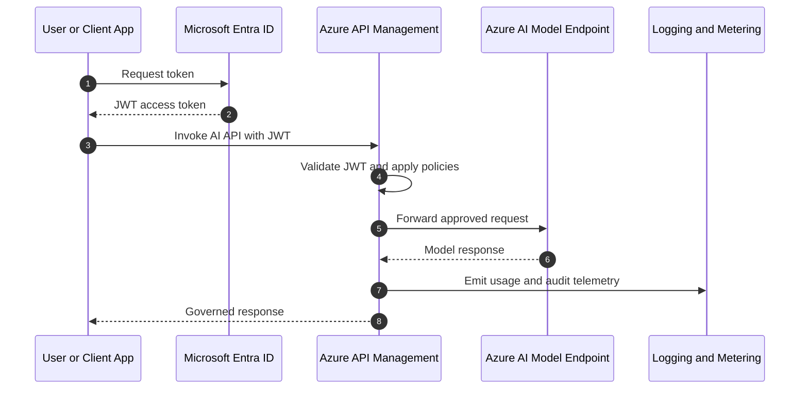

# Platform Architecture Overview

## Platform Vision

The Azure AI Platform reference architecture is designed to provision governed AI workloads in hours instead of weeks. It combines reusable infrastructure modules, environment-specific compositions, and repeatable deployment pipelines so teams can stand up secure AI capabilities quickly while staying inside enterprise guardrails.

## Component Map

| Component | Role |
|---|---|
| Hub network | Provides centralized connectivity, firewall inspection, DNS resolution, and shared network services. |
| Spoke networks | Isolate workload domains such as AI Foundry, Fabric, and APIM. |
| Azure AI Foundry | Hosts AI workspaces, model deployments, and workload-specific AI projects. |
| Azure API Management | Acts as the AI Gateway for model access, policy enforcement, metering, and MCP exposure. |
| MCP servers | Expose tools and discovery endpoints through APIM-managed APIs. |
| Microsoft Entra ID | Provides application identity, JWT issuance, group-based access, and RBAC alignment. |
| Azure Policy | Enforces governance requirements such as tagging and approved configuration. |
| Terraform modules | Provide reusable single-concern building blocks for platform resources. |
| Terraform compositions | Assemble shared modules into deployable scenarios and act as the deployment unit. |
| Azure DevOps pipelines | Orchestrate plan, review, and apply stages across sandbox, poc, and prod. |
| Remote state backend | Stores isolated Terraform state per composition and environment. |

## Data Flow

A typical request flows through the platform as follows:

1. A client application or user authenticates with Entra and receives a JWT.
2. The client sends an AI request to Azure API Management.
3. APIM validates the JWT, applies product policies, rate limits, and safety controls.
4. APIM routes the request to the appropriate AI backend or MCP-exposed tool API.
5. The AI model processes the request inside the private network boundary.
6. The response is returned through APIM with logging and usage metering applied.
7. The client receives the governed response.

## Security Model

The security model combines network isolation, identity enforcement, and governance policy:

- Hub-spoke networking keeps workload traffic inside private address space.
- Private endpoints prevent public inbound access to AI services.
- APIM centralizes authentication, authorization, throttling, and policy enforcement.
- Entra app registrations, groups, and JWT validation provide identity-based access control.
- Azure RBAC scopes operational access to the correct environment and resource boundary.
- Azure Policy enforces mandatory configuration such as tagging and approved deployment patterns.

## Deployment Model

The deployment model is infrastructure-as-code driven:

- Shared Terraform modules implement reusable resource patterns.
- Terraform compositions define deployment-ready platform slices.
- Each environment has its own tfvars, remote state, and deployment boundary.
- Azure DevOps pipelines run plan and apply stages with manual promotion between environments.
- State is stored remotely in Azure Storage with lease-based locking, soft-delete, and versioning.
