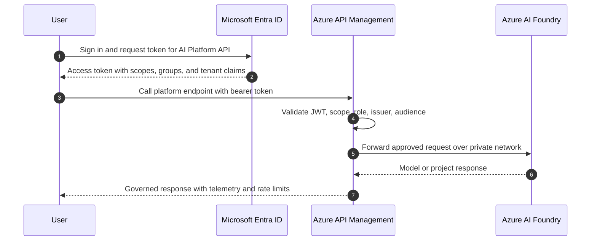
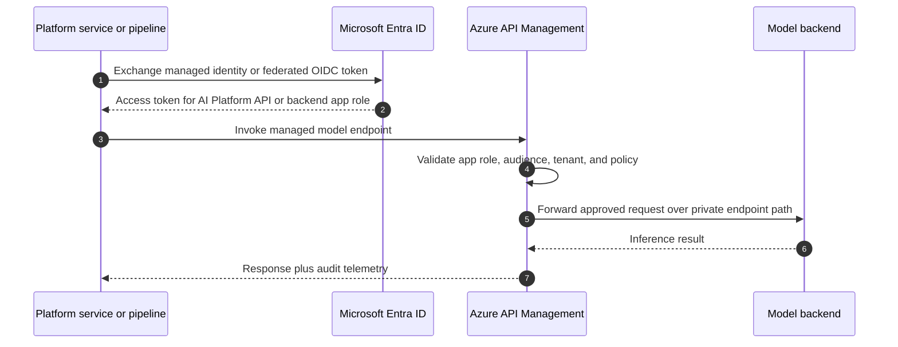
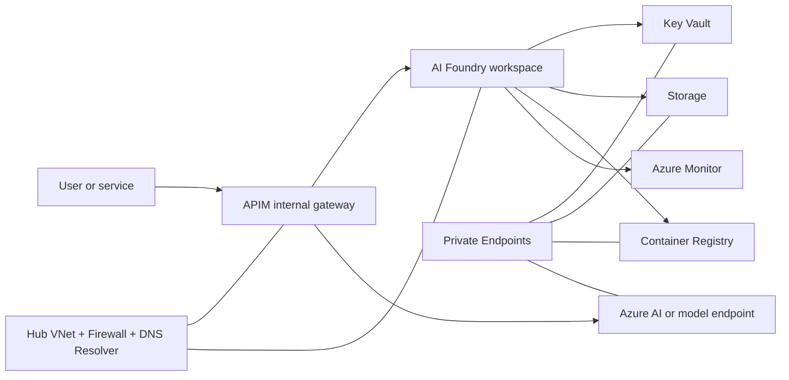

# Security Baseline

This guide defines the production security baseline for the Azure AI Platform reference architecture. It builds on ADR-0008, keeps per-component app registrations, prefers managed identities, and treats APIM as the policy enforcement point for token validation and model access.

## Zero-Trust Principles

- verify explicitly: every caller presents an Entra token, APIM validates issuer, audience, and scopes or roles, and downstream services trust APIM rather than anonymous callers
- use least privilege: app registrations, managed identities, groups, and Azure RBAC assignments are scoped to a single component or deployment boundary
- assume breach: private endpoints, deny-by-default network ACLs, policy guardrails, and logging are enabled so compromise of one component does not create lateral movement
- minimize standing secrets: use managed identities first, workload identity federation second, and Key Vault-backed certificates only when a confidential client credential is still required

## Identity Flows

### User flow: user -> APIM -> AI Foundry

Control points:

- API registration publishes `Platform.Read`, `Platform.Write`, `Platform.Admin`, `Models.Invoke`, and `Models.Deploy`
- APIM checks scopes for delegated user flows and app roles for service principals
- AI Foundry workspace access stays group-based through Azure RBAC, not direct broad subscription access

### Service flow: service -> APIM -> model

Control points:

- managed identities are the default for Azure-hosted services
- Azure DevOps or GitHub automation should use workload identity federation instead of stored client secrets
- trusted first-party applications can be pre-authorized to suppress consent prompts while still keeping a narrow scope list

## Identity Design Baseline

### App registration patterns

| Component | Purpose | Baseline |
|---|---|---|
| AI Platform API | User and service access to governed platform APIs | Publish scoped permissions and default app roles; emit only required claims |
| APIM backend identity | APIM-to-backend confidential client when managed identity alone is insufficient | Use client credential flow with certificate or workload federation; never broad multi-purpose permissions |
| DevOps service principal | Deployment automation | Use federated credentials, scoped Azure RBAC, and separate identities per environment where blast radius matters |

### Token hygiene

- prefer Entra v2 tokens
- include group claims only when APIM or downstream authorization logic needs them
- use optional claims sparingly; every extra claim increases disclosure and token size
- separate delegated user scopes from application app roles so service-to-service access cannot impersonate user consent

### Conditional Access recommendations

Conditional Access is outside this repo because it requires tenant licensing and centralized Entra administration. The recommended production baseline is:

- require phishing-resistant MFA for `Admin` operators
- require compliant or hybrid-joined devices for interactive admin access
- restrict privileged access to named locations or trusted networks
- block legacy authentication
- monitor risky sign-ins separately for human admins and workload identities

## Secret Management Strategy

- store certificates, connection strings, and break-glass secrets in Key Vault only
- do not store client secrets in Azure DevOps variable groups, pipeline YAML, or Terraform variables committed to the repo
- prefer managed identity for Azure resources and federated identity credentials for external CI/CD systems
- if a confidential client must use a certificate, store the certificate in Key Vault and rotate on a defined schedule
- give pipelines `get` permissions only for the exact Key Vault objects they need, not full secret administration

## Network Security Model

Required controls:

- APIM runs in internal mode
- AI Foundry, Key Vault, Storage, ACR, and AI services expose private endpoints only
- public network access is disabled on platform PaaS services
- NSGs restrict east-west traffic to the minimum required subnet flows
- firewall or egress controls govern outbound internet access for build, package, and model dependencies
- private DNS zones resolve platform services internally and are linked to hub and spoke VNets

## Least-Privilege RBAC Model

| Scope | Identity | Recommended role |
|---|---|---|
| Subscription or landing-zone resource group | Platform administrators group | Contributor only when required; prefer narrower resource group scope |
| AI Foundry workspace | Reader / Contributor / Admin Entra groups | Map to workspace-specific Azure RBAC roles |
| APIM resource group | APIM operators group | API Management Service Contributor or narrower custom role if introduced later |
| Key Vault | Runtime managed identities and break-glass admins | Key Vault Secrets User for consumers; avoid broad access policies |
| Pipelines | DevOps service principal | Resource-group scoped contributor plus targeted data-plane roles only |

Rules:

- keep Reader, Contributor, and Admin as the platform profile vocabulary
- do not reuse a single service principal across APIM, workloads, and pipelines
- keep role assignments environment-local wherever possible
- separate operator access from runtime identity access

## Compliance Considerations

### Data residency

- lock deployments to approved regions through policy
- ensure AI service, storage, and log destinations remain in the same approved geography unless an exception is approved
- review any cross-region failover settings before production enablement

### Content safety and logging

- log APIM access decisions, model invocation telemetry, and policy denials
- avoid logging raw prompts, completions, or secrets unless explicitly approved for a compliance scenario
- route diagnostics to central Log Analytics with retention aligned to policy and regulatory needs
- enable content safety logging only with clear retention and access controls because prompts may contain sensitive data

### Operational evidence

- keep Terraform state in a protected storage account with versioning and soft delete
- retain policy compliance results and Entra sign-in logs for audit review
- document all break-glass identities and monitor every use
