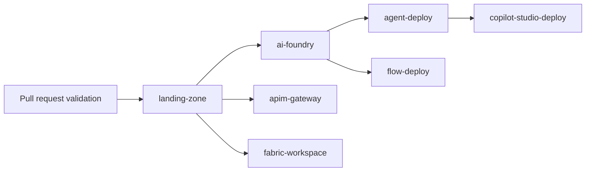

# Azure DevOps pipelines

This directory contains Azure DevOps YAML pipelines for the platform.

## Structure

- `templates\` – reusable Terraform stage templates for validate, init, plan, apply, and destroy workflows.
- `infra\` – composition pipelines for landing zone, AI Foundry, Fabric, and APIM infrastructure.
- `deploy\` – deployment pipelines for AI Foundry agents, Prompt Flow artifacts, and Copilot Studio solutions.
- `ci\` – pull request validation pipelines.

## Dependency diagram

## Environment promotion flow

Promotion is explicit and sequential: `sandbox -> poc -> prod`.

1. **Validate** – Terraform configuration, dependency checks, and provider lock files are verified.
2. **Plan** – Terraform plan artifacts are produced, checksummed, and commented back to pull requests.
3. **Apply** – Sandbox can flow automatically; poc and prod require manual approval plus Azure DevOps environment approvals.
4. **Post-apply evidence** – State backup metadata, smoke test output, and rollback guidance are published as artifacts.

For AI Foundry and APIM, the validate stage checks that landing-zone state already exists before downstream promotion continues.

## Required Azure DevOps project setup

### Service connections

Create environment-specific connections for each boundary:

- Landing zone infrastructure
- AI Foundry infrastructure
- Fabric infrastructure
- APIM infrastructure
- AI Foundry deployment
- Copilot Studio / Power Platform deployment

Document the exact variable names in `templates\variable-groups.md` and wire those names into the appropriate variable groups.

### Environments

Create Azure DevOps environments for approval enforcement:

- `infra-sandbox`
- `infra-poc`
- `infra-prod`
- `ai-agent-sandbox`, `ai-agent-poc`, `ai-agent-prod`
- `promptflow-sandbox`, `promptflow-poc`, `promptflow-prod`
- `copilot-studio-sandbox`, `copilot-studio-poc`, `copilot-studio-prod`

Configure approvals and checks on at least `infra-poc`, `infra-prod`, and the corresponding higher-environment deploy targets.

### Variable groups

Provision the backend, common, and environment-specific groups described in `templates\variable-groups.md`.

### Agent pools

Use Windows agents with:

- Terraform 1.8.x support
- Azure CLI
- PowerShell 7 for script tasks where `pwsh: true` is used
- Permission to download tools such as Infracost, Checkov, and terraform-docs

## CI pipeline coverage

`ci\pull-request.yml` enforces:

- `terraform fmt -check -recursive`
- `terraform validate` for every composition
- Checkov static analysis
- Policy asset validation
- terraform-docs generation checks

## Troubleshooting

### Plan stage fails before init
- Verify the environment-specific backend variable group is linked.
- Confirm the `.terraform.lock.hcl` file exists for the composition.
- If the state blob reports a lease, clear the stale Terraform lock before retrying.

### PR comment is missing
- Enable **Allow scripts to access the OAuth token** for the pipeline.
- Confirm the run reason is `PullRequest` and the build has permission to post PR threads.

### Downstream infrastructure blocks at validate
- Deploy or repair the landing-zone state for the target environment first.
- Check the `landing_zone_state_*` values in the environment tfvars file.

### Apply stage needs rollback
- Download the `tfapply-*` artifact from the apply stage.
- Use the saved state snapshot metadata to restore the backend blob version if required.
- Re-run `terraform plan` before any corrective apply.

### Destroy stage is blocked
- Review the published destroy inventory.
- Enable backend blob soft-delete and versioning before attempting destroy.
- Production requires two confirmations by design.